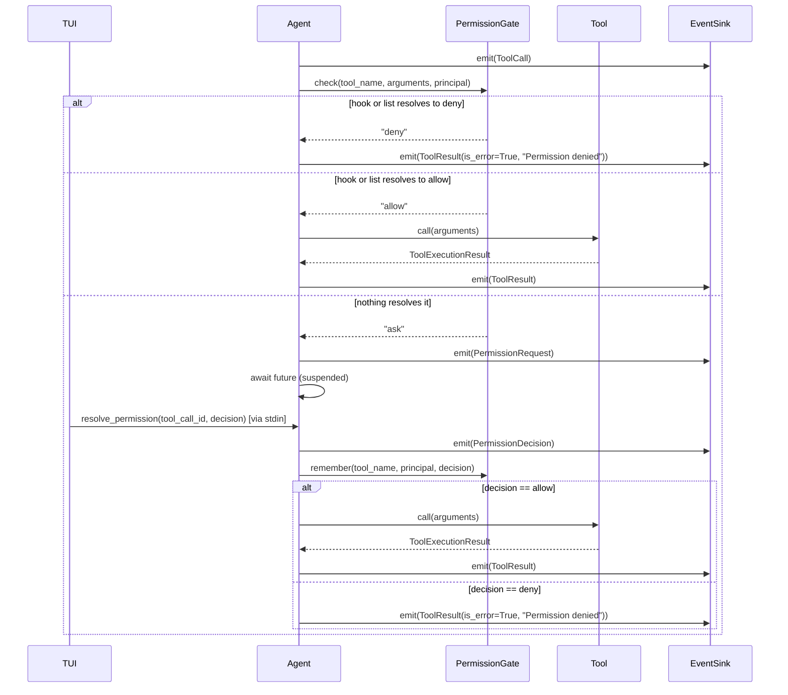

# Permission gate (MM-9) — sequence

Hand-authored. Extends the MM-8 tool round-trip: `PermissionGate.check()` runs between emitting
`ToolCall` and invoking `tool.call()`. An "ask" result suspends `Agent.run()` on an
`asyncio.Future` until `resolve_permission()` is called — see `Agent.run()` and
`docs/specs/2026-07-25-permission-gate-design.md`.

